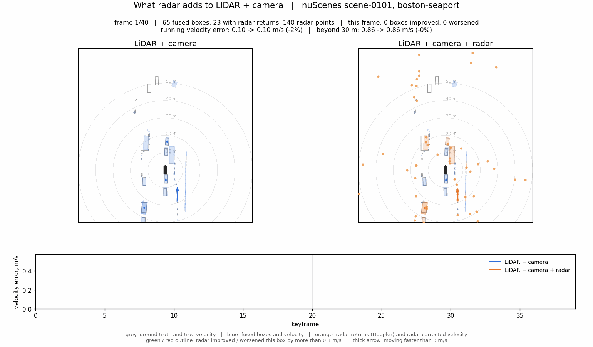
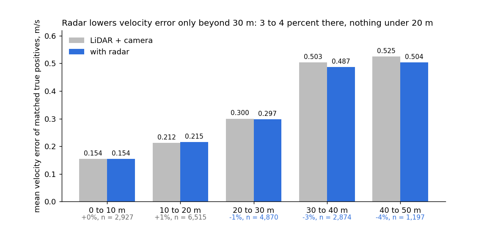
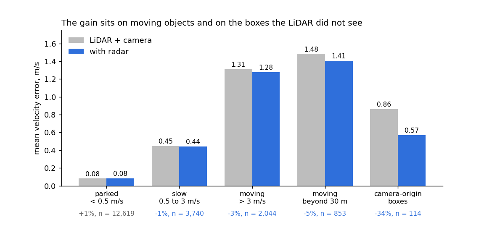

# Radar Contribution to LiDAR-Camera Fusion

*nuScenes, inference-only late fusion. 10 October 2026.*



*Left: LiDAR + camera boxes and their velocity arrows. Right: the same boxes after radar velocity fusion, with radar returns (orange) and their Doppler arrows. Grey is ground truth. Green and red outlines mark boxes whose velocity error radar improved or worsened by more than 0.1 m/s. The strip tracks the velocity error of both systems through the scene. Replay it live with `python play_enhancement.py --scene scene-0101`.*

## Summary

Adding radar to a LiDAR plus camera 3D detector on nuScenes improves velocity estimation and nothing else, and the improvement lives beyond 30 m: 4.6 percent lower velocity error there with a fixed radar weight, 5.0 percent with a distance-aware weight, against no change in detection accuracy at any range. Measured on 914 held-out validation frames with the official devkit, using public pretrained detectors and no training.

- **What radar changes:** the velocity of fused boxes. Over the full range the mean velocity error moves from 0.516 to 0.509 m/s; beyond 30 m from 0.581 to 0.552 m/s; beyond 40 m from 0.616 to 0.596 m/s. NDS, mAP, translation and orientation error are unchanged to three decimals.
- **Where it comes from:** moving objects far from the vehicle, where the LiDAR's sweep-based velocity runs out of points. Under 20 m radar adds nothing; between 30 and 50 m it removes 3 to 4 percent of the error; on moving objects beyond 30 m, 5 percent; on the few boxes that come from the camera rather than the LiDAR, 34 percent.
- **What does not work:** letting radar re-rank the boxes' confidence. That costs 1.1 NDS points and 1.7 mAP points, because the LiDAR detector's own confidence is better calibrated than a model over a handful of radar returns.
- **Why the number is small:** clear daytime scenes, a conventional radar without elevation, and a LiDAR-dominated system. Each of these is the condition under which published work also finds the smallest radar gains; the large gains in the literature come from rain, night, fog and 4D radar, none of which this subset contains.

Behind the numbers are 20,256 camera images and 29,323 LiDAR sweeps run through two public detectors on a Colab GPU, 651,498 boxes produced, and 736,169 radar returns attached to them.

## Setup

The system under test is a LiDAR plus camera 3D detector built by late fusion of two public pretrained models, and the question is what changes when the five automotive radars are added to it. Nothing is trained; every number comes from the official nuScenes devkit on held-out validation frames.

| Item | Detail |
| --- | --- |
| Data | nuScenes v1.0 trainval, blob 01: 85 scenes, 62 train and 23 validation, 2,462 and 914 keyframes. Boston and Singapore, daytime, dry |
| LiDAR detector | CenterPoint with pillar encoder, MMDetection3D checkpoint, run on the 32-beam LiDAR with 9 sweeps |
| Camera detector | FCOS3D, MMDetection3D checkpoint, run on all six cameras |
| LiDAR + camera | LiDAR-primary merge: a camera box is kept only where no same-class LiDAR box lies within 2.5 m, since monocular depth error otherwise duplicates LiDAR boxes |
| Radar | All five radars, devkit validity filters, ego-motion-compensated radial velocity, transformed to the global frame |
| Attaching radar to a box | A radar return belongs to a box when it falls inside the box footprint enlarged by 1 m in bird's-eye view |
| Using radar | Velocity: a camera-origin box takes the mean radar velocity of its returns; a LiDAR-origin box blends 10 percent radar velocity into its own, a weight fitted on training scenes. Re-scoring: a logistic re-ranker over detector score, range, class and radar features, fitted by five-fold cross-validation across validation scenes |
| Metrics | nuScenes Detection Score (NDS), mAP, and the mean true-positive errors for translation (mATE), velocity (mAVE) and orientation (mAOE). Evaluated at full range and for objects beyond 30 m |

## Scale of the experiment

The radar effect reported here rests on 18,403 matched true positives, 9,573 of them with radar returns inside the box, drawn from 202,521 radar returns over 914 validation frames. Getting there took a 2.4 GPU-hour inference run on Google Colab and a fusion stage on a laptop; nothing was trained.

**What ran on Colab.** A free T4 session downloaded nuScenes trainval blob 01 and the metadata, 32 GB, built the dataset index for the 85 scenes present, and ran the two public detectors over every keyframe of those scenes, training and validation alike, so that the fusion weights could be fitted on one split and judged on the other.

| Quantity | Training scenes | Validation scenes | Total |
| --- | --- | --- | --- |
| Scenes | 62 | 23 | 85 |
| Keyframes | 2,462 | 914 | 3,376 |
| Camera images processed, 6 per keyframe | 14,772 | 5,484 | 20,256 |
| LiDAR point clouds loaded, keyframe plus 9 sweeps | | | 29,323 sweep files |
| LiDAR boxes produced by CenterPoint | 290,756 | 108,430 | 399,186 |
| Camera boxes produced by FCOS3D | 175,179 | 77,133 | 252,312 |
| Fused LiDAR + camera boxes | | 133,655 | |
| Fused boxes above score 0.3, used for the breakdowns | | 32,443 | |
| Ground-truth boxes | 75,362 | 30,274 | 105,636 |
| Radar returns after validity filtering | 533,648 | 202,521 | 736,169 |
| GPU time on the T4 | LiDAR 21 min, camera 123 min | | 2.4 hours |

**What was fitted on what.** The detectors themselves were trained by their authors on the full nuScenes training set of 28,130 keyframes; this work does not touch their weights. The radar velocity weights were fitted on the 2,462 training keyframes, 24,623 LiDAR true positives with radar returns, then applied unchanged to the 914 validation keyframes. The radar re-ranker was fitted by five-fold cross-validation across the 23 validation scenes. Every metric in this report is computed by the official nuScenes devkit on the validation keyframes only, which the fusion stage never saw while fitting.

## Headline results

Adding radar velocity to the LiDAR plus camera system leaves detection accuracy exactly where it was and lowers velocity error only for distant objects: by 4.6 percent beyond 30 m and 2.3 percent beyond 40 m, against a 1 percent cost under 30 m and no change over the full range. Official devkit metrics on the 914 validation frames; lower is better for the three error columns.

| Range | System | NDS | mAP | mATE, m | mAVE, m/s | mAOE, rad |
| --- | --- | --- | --- | --- | --- | --- |
| Full | LiDAR + camera | 0.579 | 0.486 | 0.310 | 0.516 | 0.404 |
| Full | + radar, fixed weight | 0.579 | 0.486 | 0.310 | 0.516 | 0.404 |
| Full | + radar, distance-aware weight | 0.580 | 0.486 | 0.310 | 0.509 | 0.404 |
| Under 30 m | LiDAR + camera | 0.638 | 0.584 | 0.290 | 0.491 | 0.356 |
| Under 30 m | + radar, fixed weight | 0.638 | 0.584 | 0.290 | 0.496 | 0.356 |
| Beyond 30 m | LiDAR + camera | 0.399 | 0.257 | 0.520 | 0.581 | 0.613 |
| Beyond 30 m | + radar, fixed weight | 0.401 | 0.257 | 0.520 | 0.554 | 0.613 |
| Beyond 30 m | + radar, distance-aware weight | 0.402 | 0.257 | 0.520 | 0.552 | 0.613 |
| Beyond 40 m | LiDAR + camera | 0.242 | 0.133 | 0.710 | 0.616 | 0.761 |
| Beyond 40 m | + radar, fixed weight | 0.244 | 0.133 | 0.710 | 0.602 | 0.761 |
| Beyond 40 m | + radar, distance-aware weight | 0.244 | 0.133 | 0.710 | 0.596 | 0.761 |

The identical full-range rows for the fixed weight are not a rounding artefact. Over the whole range, most true positives are within 30 m, where the LiDAR detector already estimates velocity from its nine sweeps to about 0.5 m/s, and the 10 percent radar blend moves that by less than the third decimal. Beyond 30 m, LiDAR returns thin out, the detector's velocity estimate degrades, and the radar's direct Doppler measurement starts to carry weight.

## Where the gain comes from

The radar gain is a function of distance. Under 20 m radar changes nothing, between 20 and 30 m it is within noise, and beyond 30 m it removes 3 to 4 percent of the velocity error. This is the same shape as the published results: radar carries weight exactly where the LiDAR's own velocity estimate, built from consecutive sweeps, runs out of points.



These per-bucket figures come from our own true-positive matching, which is why they differ in level from the devkit's mAVE above: the devkit averages over its recall thresholds, this chart averages every matched box with a score of at least 0.3. Both say the same thing. Half of all true positives have at least one radar return inside their footprint (52 percent overall, 65 percent in the 40 to 50 m band), so the effect is not limited by coverage. It is limited by the conservative 10 percent blend, which was fitted over all distances at once.

**A distance-aware weight.** Fitting the radar weight separately per distance band and box origin on the training scenes gives the weights below, and applying them to the validation boxes produces the distance-aware rows in the headline table: velocity error 0.516 to 0.509 m/s at full range and 0.581 to 0.552 m/s beyond 30 m. The fitted weights are themselves a finding: the detector should trust radar six times more at 40 m than at 10 m, and a camera box should take its velocity almost entirely from radar.

| Distance band | Weight on radar, LiDAR-origin box | Weight on radar, camera-origin box |
| --- | --- | --- |
| 0 to 20 m | 0.05 | 0.80 |
| 20 to 30 m | 0.05 | 0.80 |
| 30 to 40 m | 0.10 | 0.90 |
| Beyond 40 m | 0.30 | 0.95 |

## Moving objects, box origin and class

Radar helps the objects that move and the boxes the LiDAR is least sure about. Parked objects, which are 69 percent of all true positives, gain nothing, which is expected: their velocity is zero and the LiDAR already says so.



| Slice | True positives | LiDAR + camera | With radar | Change |
| --- | --- | --- | --- | --- |
| Parked, under 0.5 m/s | 12,619 | 0.082 | 0.083 | +1.1 % |
| Slow, 0.5 to 3 m/s | 3,740 | 0.448 | 0.443 | -1.1 % |
| Moving, over 3 m/s | 2,044 | 1.312 | 1.278 | -2.6 % |
| Moving, beyond 30 m | 853 | 1.483 | 1.406 | -5.2 % |
| Moving, with radar returns | 1,443 | 1.248 | 1.199 | -3.9 % |
| LiDAR-origin boxes | 18,289 | 0.289 | 0.287 | -0.8 % |
| Camera-origin boxes | 114 | 0.863 | 0.569 | -34.0 % |

The camera-origin row is the one that shows radar's potential rather than its current contribution. Only 114 fused boxes come from the camera, because the LiDAR-primary merge keeps a camera box only where LiDAR found nothing, but on those boxes radar replaces a monocular velocity guess with a direct measurement and removes a third of the error. The system-level gain is small because the system is LiDAR-dominated, not because radar is weak.

By class, the gain follows reflectivity and motion: buses -10.2 percent (220 boxes, 91 percent with radar returns), bicycles -6.4 percent, trucks -2.3 percent, cars -2.1 percent. Pedestrians are flat at 0.339 m/s with radar returns on only 40 percent of them. Trailers show +18.6 percent on 26 boxes, which is noise at that count.

## What did not help

Letting radar change the confidence of the fused boxes, not only their velocity, makes the system worse. A logistic re-ranker over detector score, range, class and radar features, fitted by five-fold cross-validation across validation scenes so that no box is scored by a model that has seen it, lowers NDS by 1.1 points and mAP by 1.7 points at full range and by more beyond 30 m.

| Range | System | NDS | mAP | mAVE, m/s |
| --- | --- | --- | --- | --- |
| Full | LiDAR + camera + radar velocity | 0.579 | 0.486 | 0.516 |
| Full | LiDAR + camera + radar re-scoring and velocity | 0.568 | 0.469 | 0.545 |
| Beyond 30 m | LiDAR + camera + radar velocity | 0.401 | 0.257 | 0.554 |
| Beyond 30 m | LiDAR + camera + radar re-scoring and velocity | 0.389 | 0.236 | 0.559 |

The reason is calibration. The LiDAR detector's own confidence, learned from 28,000 training frames, ranks its boxes better than a linear model over a handful of radar counts can. Radar returns are also present on many false positives, such as guard rails and parked vehicles beyond the annotated set, so "has radar returns" is a weak signal of correctness on nuScenes' sparse conventional radar. The conclusion: on this system, radar should correct velocity and leave confidence alone.

## Limits of this measurement

The numbers are small and they are measured on the conditions least favourable to radar, so they should be read as a floor, not a ceiling.

- **Clear daytime scenes only.** The 23 validation scenes in this blob contain no rain and no night. Every published result that shows radar's largest gains does so in rain, fog, snow or darkness, where LiDAR and camera degrade and radar does not. A second nuScenes blob with rain and night scenes, or a LiDAR-dropout run, would measure that side.
- **Conventional radar.** nuScenes radars report no elevation and a few hundred returns per frame. 4D radars on View-of-Delft and K-Radar give elevation and ten times the density, and fusion gains there are several mAP points rather than fractions of a point on velocity.
- **Subset size.** 914 frames from 23 scenes. Differences under about 0.01 NDS or 0.01 m/s on the devkit metrics are within noise. The per-bucket breakdowns rest on thousands of boxes each, except the trailer and motorcycle rows.
- **No training.** The detectors are public checkpoints trained by their authors on the full nuScenes training set, which includes this blob's training scenes. That is why anything fitted here is fitted by cross-validation on validation scenes, and why the fusion rules are kept to a velocity blend and a merge radius. A learned fusion head trained on radar features could do more.
- **LiDAR-primary design.** The merge keeps camera boxes only where LiDAR finds nothing, so radar's large effect on camera boxes touches 114 of 18,403 true positives. A system that leaned more on the camera, or a weaker LiDAR, would show a larger radar contribution.

## Reproducing and visualizing

This folder is self-contained and needs only numpy and matplotlib:

```
pip install -r requirements.txt
python play_enhancement.py --scene scene-0101
python play_enhancement.py --scene scene-0093 --save demo_scene-0093.gif
```

A second rendered scene is in [demo_scene-0093.gif](demo_scene-0093.gif). The data files behind the player, one per scene under `data/`, carry ego pose, ground-truth boxes with velocity, the fused boxes with velocity before and after radar, the radar returns with compensated velocity, and the per-box velocity error. No images or point clouds are included. The parent project's `scripts/` folder holds the fusion (`fuse.py`), evaluation (`evaluate.py`), breakdown (`analyze_lc_radar.py`), distance-aware blend (`blend_by_distance.py`), data export (`export_viz_data.py`) and figure (`make_report_figures.py`) code, and `colab/nuscenes_inference.ipynb` is the notebook that produced the detections.

## Sources

- nuScenes: Caesar et al., *nuScenes: A multimodal dataset for autonomous driving*, CVPR 2020. Data used under CC BY-NC-SA 4.0 for non-commercial research.
- CenterPoint: Yin, Zhou and Krähenbühl, *Center-based 3D Object Detection and Tracking*, CVPR 2021. Checkpoint from MMDetection3D.
- FCOS3D: Wang et al., *FCOS3D: Fully Convolutional One-Stage Monocular 3D Object Detection*, ICCV Workshops 2021. Checkpoint from MMDetection3D.
- MMDetection3D: OpenMMLab, version 1.4.0.
