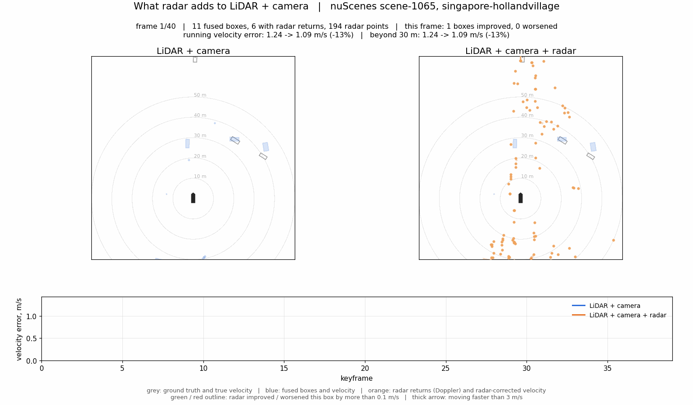

# Radar Contribution to LiDAR-Camera Fusion, Day and Night

*nuScenes, inference-only late fusion over two blobs. 11 October 2026, degradation row added 12 October 2026. This report extends [REPORT.md](REPORT.md), the daytime-only study of 10 October, with the night and rain scenes of a second blob; the first report is kept unchanged.*



*Scene 1065, rain at night, Singapore. Left: LiDAR + camera boxes and their velocity arrows. Right: the same boxes after radar velocity fusion, with radar returns (orange) and their Doppler arrows. Grey is ground truth. Green and red outlines mark boxes whose velocity error radar improved or worsened by more than 0.1 m/s. Replay it live with `python play_enhancement.py --scene scene-1065`; the daytime scenes of the first report are `scene-0101` and `scene-0093`.*

## Summary

Adding the night and rain scenes of a second nuScenes blob to the first report's daytime scenes doubles radar's measured contribution to the LiDAR plus camera system, and the shape of the result is the one the literature predicts: radar helps where the other sensors are weakest. By day, radar velocity changes nothing at full range and cuts velocity error 4.6 percent beyond 30 m. At night it cuts velocity error 4.4 percent at full range and 4.6 percent beyond 30 m on the classes the scenes contain, 6.7 percent beyond 30 m with a distance-aware weight (2 to 3 percent on the official metric, which is padded by absent classes). In the three rain-at-night scenes the cut is 7.6 percent. Detection accuracy is unchanged in every condition. All numbers come from the official nuScenes devkit on held-out validation frames, with public pretrained detectors and no training.

- **Daytime, 914 frames (first report):** LiDAR plus camera velocity error 0.516 m/s with or without radar at full range; 0.581 to 0.554 m/s beyond 30 m. NDS 0.579 either way.
- **Night, 602 frames, 15 scenes:** velocity error on the classes present 0.521 to 0.498 m/s at full range and 0.760 to 0.725 m/s beyond 30 m; on cars beyond 30 m, 0.807 to 0.776 m/s. Official rows: 0.701 to 0.686 and 0.880 to 0.862 m/s; NDS 0.342 to 0.344.
- **Rain at night, 120 frames, 3 scenes:** velocity error 0.866 to 0.800 m/s on the official metric and 0.440 to 0.417 m/s on the two classes present, cars 0.465 to 0.445 m/s; NDS 0.214 to 0.221. Too few frames for a firm number, but the direction matches.
- **The camera alone gains far more.** At night its velocity error falls from 1.367 to 1.022 m/s with radar, and from 1.951 to 1.184 m/s beyond 30 m; in rain from 2.191 to 1.174 m/s.
- **Re-scoring boxes with radar still does not pay.** It costs 1.1 NDS points by day and 0.3 at night, where it also drops far-range car AP from 0.573 to 0.474. It is the only method that helped in the three rain scenes, which is too little evidence to act on.
- **Degrading the LiDAR does not make radar matter more.** With a random 25 percent of the LiDAR points kept, the fused system loses 1.7 NDS and 3.6 mAP points and radar velocity still changes nothing at full range; beyond 30 m it cuts velocity error 3.5 percent with the fixed weight and 5.1 percent with the distance-aware weight, against 4.6 and 5.0 percent with clean LiDAR. The refitted far-range weights rise, the error removed does not. The difference is within noise.
- **Read the night rows with care.** The night scenes are residential streets with cars and motorcycles and no buses, trailers or construction vehicles. The devkit scores an absent class as zero AP and a velocity error of 1.0 m/s, so the night mAP and mAVE carry padding that no system can remove; the comparisons between systems within a slice are unaffected.


*Mean velocity error of the LiDAR + camera system and of the camera alone, with and without radar velocity, by condition and range. Night values are averaged over the classes present in the night scenes; day values are the official devkit numbers over all ten classes. The two right-hand bars of the fused panel are the daytime frames with a random 25 percent of the LiDAR points kept.*

## Setup

The system under test, the fusion rules and the metrics are those of the first report. What changed is the data: a second nuScenes blob whose validation scenes are all at night, three of them in rain, so the same measurement can be repeated under the conditions the published radar results single out.

| Item | Detail |
| --- | --- |
| Data | nuScenes v1.0 trainval, blobs 01 and 10. Blob 01: 85 scenes, Boston and Singapore, daytime, dry; 23 validation scenes, 914 keyframes. Blob 10: 85 scenes; its 15 validation scenes (scene-1059 to scene-1073, Singapore Holland Village) are all night, 602 keyframes, and 3 of them are also rain, 120 keyframes |
| LiDAR detector | CenterPoint with pillar encoder, MMDetection3D checkpoint, 32-beam LiDAR with 9 sweeps |
| Camera detector | FCOS3D, MMDetection3D checkpoint, all six cameras |
| LiDAR + camera | LiDAR-primary merge: a camera box is kept only where no same-class LiDAR box lies within 2.5 m |
| Radar | All five radars, devkit validity filters, ego-motion-compensated radial velocity in the global frame; a return belongs to a box when it falls inside the box footprint enlarged by 1 m |
| Using radar | Velocity: a camera-origin box takes the mean radar velocity of its returns; a LiDAR-origin box blends 10 percent radar velocity into its own. The weight was refitted on the training scenes of both blobs and came out at the same 0.1. Re-scoring: a logistic re-ranker over detector score, range, class and radar features, fitted by five-fold cross-validation across the 38 validation scenes |
| Slices | Day = the 914 blob 01 frames, taken from the first report. Night = the 602 blob 10 frames. Rain = the 120 blob 10 frames whose scene description says rain. Each slice is also evaluated on objects beyond 30 m |
| Metrics | nuScenes Detection Score (NDS), mAP, and the mean true-positive errors for translation (mATE) and velocity (mAVE). Where a slice lacks a class, the per-class values are also averaged over the classes present |

## Scale of the experiment

The second blob added 3,420 keyframes to the 3,376 of the first, and a second 3-hour GPU run on Colab (this time on a paid T4 session) produced its detections on 11 October 2026. The night validation frames are sparser than the daytime ones: 7.5 annotated objects per frame against 33, and almost all of them cars and motorcycles.

| Quantity | Day (blob 01) | Night (blob 10) | Rain at night (subset of blob 10) |
| --- | --- | --- | --- |
| Validation scenes | 23 | 15 | 3 |
| Validation keyframes | 914 | 602 | 120 |
| Training keyframes used to fit the velocity weight | 2,462 | 2,818 | included in night |
| Ground-truth boxes, validation | 30,274 | 4,498 | 549 |
| Ground-truth boxes per frame | 33.1 | 7.5 | 4.6 |
| Classes with at least 20 ground-truth boxes | all 10 | car 3,457, motorcycle 346, barrier 259, truck 189, pedestrian 120, traffic cone 82, bicycle 45 | car 490, pedestrian 29 |
| Classes with no ground truth | none | bus, trailer, construction vehicle | bus, trailer, construction vehicle, bicycle, traffic cone, barrier |
| LiDAR boxes from CenterPoint, validation | 108,430 | 70,943 | |
| Camera boxes from FCOS3D, validation | 77,133 | 14,700 | |
| Camera boxes per frame | 84 | 24 | |
| GPU time on the T4 | LiDAR 21 min, camera 123 min | LiDAR 17 min, camera 121 min | |

The camera detector's output collapses at night: 24 boxes per frame against 84 by day, with the same score threshold. The LiDAR detector's output per frame is similar in both blobs. The velocity weight for LiDAR boxes was refitted on 40,358 LiDAR true positives from the training scenes of both blobs and came out at 0.1, the same as on blob 01 alone, so the daytime rows of the first report and the night rows here use the same fusion.

## Headline results by condition

Radar velocity leaves NDS and mAP unchanged in every condition and lowers velocity error more as conditions worsen: nothing by day at full range, 2 percent at night, 8 percent in rain at night, and 2 to 5 percent beyond 30 m. The day rows are the first report's; the night and rain rows are new. Official devkit values, lower error is better.

| Condition | Range | System | NDS | mAP | mATE, m | mAVE, m/s |
| --- | --- | --- | --- | --- | --- | --- |
| Day | Full | LiDAR + camera | 0.579 | 0.486 | 0.310 | 0.516 |
| Day | Full | + radar velocity | 0.579 | 0.486 | 0.310 | 0.516 |
| Day | Beyond 30 m | LiDAR + camera | 0.399 | 0.257 | 0.520 | 0.581 |
| Day | Beyond 30 m | + radar velocity | 0.401 | 0.257 | 0.520 | 0.554 |
| Night | Full | LiDAR + camera | 0.342 | 0.245 | 0.518 | 0.701 |
| Night | Full | + radar velocity | 0.344 | 0.245 | 0.518 | 0.686 |
| Night | Beyond 30 m | LiDAR + camera | 0.215 | 0.147 | 0.708 | 0.880 |
| Night | Beyond 30 m | + radar velocity | 0.217 | 0.147 | 0.708 | 0.862 |
| Rain at night | Full | LiDAR + camera | 0.214 | 0.185 | 0.683 | 0.866 |
| Rain at night | Full | + radar velocity | 0.221 | 0.185 | 0.683 | 0.800 |

The night and rain NDS and mAP values are low for every system because the devkit averages over all ten classes and these scenes contain no bus, trailer or construction vehicle; car AP for LiDAR plus camera is 0.85 at night against 0.86 by day. The same padding adds a fixed amount to the night mAVE of every system, so the relative gains above are understated; the per-class rows in the next section show the effect on the objects that are there.

## Night, on the classes that are there

Averaged over the classes with at least 20 ground-truth boxes in the slice, radar velocity cuts the fused system's velocity error 4.4 percent at night at full range and 4.6 percent beyond 30 m, and the camera's by 35 and 53 percent. Detection accuracy does not change. These are the night numbers to quote; the official devkit rows above carry the padding from absent classes.

| Range | Classes averaged (ground-truth boxes) | System | mAP | mAVE, m/s | Car AP | Car mAVE, m/s |
| --- | --- | --- | --- | --- | --- | --- |
| Full | car 3,457, motorcycle 346, barrier 259, truck 189, pedestrian 120, traffic cone 82, bicycle 45 | LiDAR + camera | 0.350 | 0.521 | 0.852 | 0.504 |
| Full | same | + radar velocity | 0.350 | 0.498 | 0.852 | 0.484 |
| Full | same | Camera | 0.199 | 1.587 | 0.420 | 2.144 |
| Full | same | Camera + radar velocity | 0.199 | 1.034 | 0.420 | 1.164 |
| Beyond 30 m | car 1,627, barrier 159, motorcycle 118, truck 115, pedestrian 52 | LiDAR + camera | 0.293 | 0.760 | 0.573 | 0.807 |
| Beyond 30 m | same | + radar velocity | 0.293 | 0.725 | 0.573 | 0.776 |
| Beyond 30 m | same | Camera | 0.030 | 2.903 | 0.127 | 2.707 |
| Beyond 30 m | same | Camera + radar velocity | 0.030 | 1.367 | 0.127 | 1.690 |

Per class beyond 30 m, the fused system's velocity error with radar goes from 0.807 to 0.776 m/s on cars, 0.735 to 0.691 on trucks, 1.310 to 1.261 on motorcycles and 0.187 to 0.171 on pedestrians. The daytime equivalent from the first report was 0.581 to 0.554 m/s on the official metric over all ten classes, a 4.6 percent cut; night therefore matches the daytime far-range gain and adds a gain at full range that daytime does not have. The reason is the LiDAR's own velocity estimate: it comes from point motion across sweeps, and at night the residential scenes have fewer points per object and more objects with low contrast, so the detector's velocities are noisier and radar's Doppler measurement, which is unchanged, is worth more.

## A distance-aware weight, refitted on both blobs

Refitting the per-distance radar weight on the training scenes of both blobs raises the far-range weights and gives the lowest far-range velocity error in every condition, again with no change to NDS or mAP. On LiDAR-origin boxes the weights are 0.05, 0.10, 0.15 and 0.35 for 0 to 20, 20 to 30, 30 to 40 and beyond 40 m, against 0.05, 0.05, 0.10 and 0.30 when fitted on daytime data alone; on camera-origin boxes 0.85, 0.80, 0.90 and 0.95. The night training scenes, where the LiDAR's own velocities are noisier, are what moved the far weights.

| Condition | Range | LiDAR + camera | + radar, fixed 0.1 | + radar, distance-aware |
| --- | --- | --- | --- | --- |
| Day, 914 frames (first report, weights fitted on day only) | Full | 0.516 | 0.516 | 0.509 |
| Day | Beyond 30 m | 0.581 | 0.554 | 0.552 |
| Night, 602 frames | Full | 0.701 | 0.686 | 0.688 |
| Night | Beyond 30 m | 0.880 | 0.862 | 0.854 |
| Rain at night, 120 frames | Full | 0.866 | 0.800 | 0.805 |
| Day and night together, 1,516 frames | Full | 0.521 | 0.518 | 0.510 |
| Day and night together | Beyond 30 m | 0.607 | 0.574 | 0.567 |

Mean velocity error in m/s, official devkit values. The day-and-night rows pool both blobs and are dominated by the daytime frames' 30,274 ground-truth boxes; their NDS is 0.579, 0.579 and 0.580 at full range and 0.398, 0.401 and 0.402 beyond 30 m for the three systems. At full range at night the fixed and distance-aware weights are within 0.002 m/s of each other; the distance-aware weight earns its keep beyond 30 m, where it removes 3.0 percent of the night error against 2.0 percent for the fixed weight on the official metric, and 6.7 percent against 4.6 percent on the classes present (0.760 to 0.709 m/s; cars 0.807 to 0.766 m/s).

## When the LiDAR is degraded

Keeping a random quarter of the LiDAR points costs the LiDAR plus camera system 1.7 NDS points and 3.6 mAP points at full range, and radar's contribution stays the size it was with clean LiDAR: nothing at full range, and a 3.5 percent cut in far-range velocity error with the fixed weight or 5.1 percent with the distance-aware weight, against 4.6 and 5.0 percent before. Refitting the distance-aware weights on the degraded training frames does move the far weights up, from 0.10 and 0.30 to 0.20 and 0.45 for 30 to 40 m and beyond 40 m, so the fusion leans harder on radar once the LiDAR's own velocities get worse; the error it removes is about the same, and the difference between the two conditions is within the noise of 914 frames. The run was made on 12 October 2026 on the same daytime validation frames, ground truth, camera detections and fusion rules as the day rows above.

The degradation is a uniform random subsample of the aggregated point cloud (keyframe plus nine sweeps) applied before the detector, one draw, with the detector left as published. It models sparse returns, not rain or fog, which thin a cloud selectively. The LiDAR detector loses 3.8 mAP points at full range and 4.4 beyond 30 m; motorcycle AP halves (0.167 to 0.082) and far pedestrian AP falls from 0.708 to 0.600. The refitted single velocity weight came out at 0.1, the same as with clean LiDAR, so the fixed-weight row is also the refitted row.

| Range | System | NDS | mAP | mAVE, m/s | NDS, 25 % LiDAR | mAP, 25 % LiDAR | mAVE, 25 % LiDAR |
| --- | --- | --- | --- | --- | --- | --- | --- |
| Full | LiDAR | 0.578 | 0.483 | 0.522 | 0.562 | 0.445 | 0.476 |
| Full | LiDAR + camera | 0.579 | 0.486 | 0.516 | 0.562 | 0.450 | 0.476 |
| Full | + radar velocity, 0.1 | 0.579 | 0.486 | 0.516 | 0.562 | 0.450 | 0.478 |
| Full | + radar velocity, distance-aware | 0.580 | 0.486 | 0.509 | 0.563 | 0.450 | 0.468 |
| Full | + radar re-scoring | 0.568 | 0.469 | 0.545 | 0.547 | 0.434 | 0.541 |
| Beyond 30 m | LiDAR | 0.400 | 0.257 | 0.574 | 0.369 | 0.213 | 0.634 |
| Beyond 30 m | LiDAR + camera | 0.399 | 0.257 | 0.581 | 0.370 | 0.215 | 0.626 |
| Beyond 30 m | + radar velocity, 0.1 | 0.401 | 0.257 | 0.554 | 0.372 | 0.215 | 0.604 |
| Beyond 30 m | + radar velocity, distance-aware | 0.402 | 0.257 | 0.552 | 0.373 | 0.215 | 0.594 |
| Beyond 30 m | + radar re-scoring | 0.389 | 0.236 | 0.559 | 0.361 | 0.197 | 0.622 |

Official devkit values on the 914 daytime frames; the left group is the clean LiDAR of the first report, the right group the same pipeline with 25 percent of the points. The full-range velocity error falls under degradation (0.516 to 0.476 m/s) because the set of matched objects changes, not because the velocities improve: the degraded detector finds 17,354 true positives instead of 18,403 and loses the far, hard ones first, and the error is averaged over what is found. Beyond 30 m, where the matched set is more alike, the error rises from 0.581 to 0.626 m/s as expected. Radar velocity never adds or removes a box, so mAP is identical with and without it in both conditions.

| Range | System | Car | Truck | Pedestrian | Motorcycle |
| --- | --- | --- | --- | --- | --- |
| Beyond 30 m, clean | LiDAR + camera | 0.457 | 0.340 | 0.291 | 1.243 |
| Beyond 30 m, clean | + radar velocity | 0.442 | 0.315 | 0.289 | 1.250 |
| Beyond 30 m, 25 % LiDAR | LiDAR + camera | 0.538 | 0.378 | 0.342 | 1.563 |
| Beyond 30 m, 25 % LiDAR | + radar velocity | 0.513 | 0.355 | 0.340 | 1.539 |

Velocity error in m/s by class beyond 30 m, fixed weight 0.1. Per class the pattern is the clean one: radar removes 4.6 percent of the far car error with degraded LiDAR against 3.3 percent clean, 6.1 against 7.4 percent on trucks, nothing on pedestrians, and 1.5 percent on motorcycles where the clean run showed no change; the differences between conditions are a few hundredths of a metre per second on a few hundred objects.

The box-origin breakdown says the same. Over all true positives of the fused system, radar velocity cuts the error 1.8 percent with degraded LiDAR against 1.4 percent clean; on moving objects beyond 30 m, 5.6 against 5.2 percent; on objects at 40 to 50 m, 5.6 against 4.1 percent; on LiDAR-origin boxes, 1.4 against 0.8 percent. Every one of these is a small step in the expected direction, and none is large enough to call a result on its own. The camera-origin boxes, the ones radar helps most, grow from 114 to 161 of the fused true positives because fewer LiDAR boxes are there to suppress them, and their velocity gain shrinks from 34 to 19 percent because the extra survivors are harder objects. The share of true positives with at least one radar return is unchanged at 52 to 53 percent.

Re-scoring with radar still hurts, and by more: 1.5 NDS points at full range and 1.8 mAP points beyond 30 m, against 1.1 and 2.1 with clean LiDAR. A degraded detector's confidence is still better calibrated than a linear model over radar counts.

## Camera plus radar at night

The camera-only detector is where radar matters most, and night makes that larger still: radar velocity removes a quarter of the camera's velocity error at night at full range, two fifths beyond 30 m, and nearly half in rain (0.44 to 0.42 m/s for the fused system and 1.23 to 0.64 m/s for the camera on the classes present), against 29 percent by day. Detection accuracy does not move, because the radar only replaces velocities and never adds or removes a box.

| Condition | Range | System | NDS | mAP | mAVE, m/s | Change |
| --- | --- | --- | --- | --- | --- | --- |
| Day | Full | Camera | 0.406 | 0.315 | 2.071 | |
| Day | Full | + radar velocity | 0.406 | 0.315 | 1.469 | -29 % |
| Day | Beyond 30 m | Camera | 0.231 | 0.105 | 1.275 | |
| Day | Beyond 30 m | + radar velocity | 0.262 | 0.105 | 0.694 | -46 % |
| Night | Full | Camera | 0.222 | 0.140 | 1.367 | |
| Night | Full | + radar velocity | 0.222 | 0.140 | 1.022 | -25 % |
| Night | Beyond 30 m | Camera | 0.105 | 0.015 | 1.951 | |
| Night | Beyond 30 m | + radar velocity | 0.105 | 0.015 | 1.184 | -39 % |
| Rain at night | Full | Camera | 0.135 | 0.101 | 2.191 | |
| Rain at night | Full | + radar velocity | 0.135 | 0.101 | 1.174 | -46 % |

Per class, the night gains beyond 30 m are larger than the averages show: car velocity error 2.71 to 1.69 m/s, truck 3.89 to 2.01 m/s, motorcycle 4.43 to 1.15 m/s. The camera's own night velocity estimates are close to useless for moving objects at range, and radar's Doppler measurement does not care about the lighting. The camera's detection rate is the problem radar cannot fix in this late-fusion design: 24 boxes per frame at night against 84 by day, and a far-range night mAP of 0.015, mean that there are few camera boxes left for radar to improve.

The LiDAR-only system shows the same pattern at a smaller scale: at night its velocity error goes from 0.699 to 0.685 m/s at full range and from 0.877 to 0.860 m/s beyond 30 m with radar, the same 2 percent as the fused system, since the fused system's boxes are almost all LiDAR boxes.

## What did not help

Letting radar re-rank the boxes' confidence costs accuracy by day and by night, and the night cost falls on exactly the objects radar should help: far cars. The re-ranker was refitted by five-fold cross-validation across all 38 validation scenes, so it had night scenes in its training folds; the result did not change.

| Condition | Range | System | NDS | mAP | mAVE, m/s | Car AP |
| --- | --- | --- | --- | --- | --- | --- |
| Day | Full | LiDAR + camera + radar velocity | 0.579 | 0.486 | 0.516 | |
| Day | Full | + radar re-scoring | 0.568 | 0.469 | 0.545 | |
| Night | Full | LiDAR + camera + radar velocity | 0.344 | 0.245 | 0.686 | 0.852 |
| Night | Full | + radar re-scoring | 0.339 | 0.239 | 0.698 | 0.816 |
| Night | Beyond 30 m | LiDAR + camera + radar velocity | 0.217 | 0.147 | 0.862 | 0.573 |
| Night | Beyond 30 m | + radar re-scoring | 0.214 | 0.141 | 0.877 | 0.474 |
| Rain at night | Full | LiDAR + camera + radar velocity | 0.221 | 0.185 | 0.800 | 0.816 |
| Rain at night | Full | + radar re-scoring | 0.236 | 0.217 | 0.814 | 0.769 |

The rain row is the one exception, and it should not be read as a result: it rests on 120 frames and 549 ground-truth boxes, 490 of them cars, in three consecutive scenes of one street. Its mAP rise comes from the classes with 12 to 29 boxes, while car AP, on 490 boxes, falls from 0.816 to 0.769; a 3-point mAP swing on that base is within what reordering a few dozen boxes can do. On the two classes with enough boxes, car and pedestrian, re-scoring lowers mAP from 0.438 to 0.417 in rain as it does everywhere else. It is a reason to measure re-scoring on a larger rain set, not a reason to deploy it.

The explanation from the first report holds: the LiDAR detector's own confidence, learned from 28,000 training frames, ranks boxes better than a linear model over a handful of radar counts, and radar returns sit on many false positives too. At night the LiDAR's confidence is as well calibrated as by day, so there is still nothing for the re-ranker to fix.

## Limits of this measurement

The night and rain rows measure what the literature says they should, but on a small and lopsided slice; the limits below are the reasons the numbers are stated as directions with magnitudes rather than as benchmarks.

- **Class padding in the small slices.** The devkit averages over ten classes and gives an absent class AP 0 and a velocity error of 1.0 m/s. The night scenes have no bus, trailer or construction vehicle, so three tenths of the night mAP is zero by construction and three eighths of the night mAVE is padding. This depresses every system equally within a slice, so the comparisons stand, but night NDS cannot be compared to day NDS. The per-class rows and the present-class averages are the honest night numbers.
- **No daytime rain.** Every rain frame in blob 10 is also a night frame, so rain and night cannot be separated here. The three rain scenes are consecutive drives on one residential street; 120 frames and 549 ground-truth boxes, 490 of them cars, is enough to show the direction of the radar velocity effect and not enough to size it to better than a few percent.
- **One place at night.** All 15 night scenes come from Singapore's Holland Village, residential streets with parked cars and scooters. Night on a highway or in a city centre would have more far objects and more classes.
- **Subset size.** Daytime 914 frames from 23 scenes, night 602 from 15. Differences under about 0.01 NDS or 0.01 m/s are within noise; the far-range night rows rest on a few hundred objects.
- **Conventional radar and a LiDAR-primary design.** As in the first report: nuScenes radars report no elevation and a few hundred returns per frame, and the fused system keeps camera boxes only where LiDAR finds nothing, so radar's large effect on camera boxes touches few fused boxes. A camera-heavier system, or a 4D radar, would show a larger contribution.
- **One degradation, one draw.** The LiDAR degradation keeps a uniform random 25 percent of the points of the aggregated 10-sweep cloud, drawn once, with the detector unchanged. It stands for sparse returns, not for weather, which removes points selectively, and a detector tuned for sparse clouds would lose less. A heavier cut or a second draw would say whether the far-range weights keep rising.
- **No training.** The detectors are the public checkpoints, trained by their authors on the full nuScenes training set, which includes both blobs' training scenes. Everything fitted here is a velocity weight on training scenes or a re-ranker cross-validated on validation scenes.

## Reproducing

Everything runs from the project folder, with the two blobs extracted into one nuScenes root. The Colab notebook `colab/nuscenes_inference.ipynb` produced the blob 10 detections with its settings cell pointed at blob 10 and camera sweeps excluded from the extract.

```
cd D:\moath\radar-fusion
.venv\Scripts\python.exe scripts\merge_detections.py --out detections\centerpoint_b1b10.json detections\centerpoint.json detections\centerpoint_blob10.json
.venv\Scripts\python.exe scripts\merge_detections.py --out detections\fcos3d_b1b10.json detections\fcos3d.json detections\fcos3d_blob10.json
.venv\Scripts\python.exe scripts\fuse.py --dataroot data\nuscenes --lidar detections\centerpoint_b1b10.json --camera detections\fcos3d_b1b10.json --out results\fused_b1b10 --fit-on cv
.venv\Scripts\python.exe scripts\evaluate.py --dataroot data\nuscenes --results results\fused_b1b10 --out results\eval_b1b10 --scene-keyword night
.venv\Scripts\python.exe scripts\evaluate.py --dataroot data\nuscenes --results results\fused_b1b10 --out results\eval_b1b10 --scene-keyword night --min-range 30
.venv\Scripts\python.exe scripts\evaluate.py --dataroot data\nuscenes --results results\fused_b1b10 --out results\eval_b1b10 --scene-keyword rain
.venv\Scripts\python.exe scripts\slice_metrics.py --summary results\eval_b1b10\summary_min0_max0_night.json --dataroot data\nuscenes --scene-keyword night
```

The degradation row reruns the notebook with `LIDAR_KEEP_RATIO = 0.25` and `SKIP_CAMERA = True` on blob 01 (the `PointSample` step is inserted after the multi-sweep loader), then:

```
.venv\Scripts\python.exe scripts\fuse.py --dataroot data\nuscenes --lidar detections\centerpoint_keep25.json --camera detections\fcos3d.json --out results\fused_keep25 --fit-on cv
.venv\Scripts\python.exe scripts\blend_by_distance.py --dataroot data\nuscenes --lidar detections\centerpoint_keep25.json --camera detections\fcos3d.json --base results\fused_keep25\L+C.json --out results\fused_keep25_la\L+C+Ra.json --summary results\blend_by_distance_keep25.json
.venv\Scripts\python.exe scripts\evaluate.py --dataroot data\nuscenes --results results\fused_keep25 --out results\eval_keep25
.venv\Scripts\python.exe scripts\evaluate.py --dataroot data\nuscenes --results results\fused_keep25 --out results\eval_keep25 --min-range 30
.venv\Scripts\python.exe scripts\analyze_lc_radar.py --dataroot data\nuscenes --base results\fused_keep25\L+C.json --radar results\fused_keep25\L+C+Rv.json --lidar results\fused_keep25\L.json --out results\analysis_lc_radar_keep25.json
.venv\Scripts\python.exe scripts\degradation_tables.py --out results\degradation_keep25.json
```

The same two evaluations run on `results\fused_keep25_la` with `--out results\eval_keep25_la`. The `--blend-a` option of `fuse.py` pins the LiDAR velocity weight for a like-for-like row; it was not needed here because the refit returned the clean value.

The animation data for the night scene was exported with `scripts/export_viz_data.py --base results/fused_b1b10/L+C.json --radar results/fused_b1b10/L+C+Rv.json --lidar results/fused_b1b10/L.json --scenes scene-1065` and rendered with `python play_enhancement.py --scene scene-1065 --save demo_scene-1065.mp4` (or `.gif`).

Files: `detections/centerpoint_blob10.json` and `detections/fcos3d_blob10.json` (3,420 keyframes each, Colab run of 11 October 2026); `results/fused_b1b10/` (nine fused result files over 1,516 validation frames); `results/eval_b1b10/summary_<slice>.json` (devkit metrics with per-class AP and errors) and `present_<slice>.json` (averages over the classes present). The daytime rows are `results/eval/` and `results/eval_lc/` from the first report. The degradation row is `detections/centerpoint_keep25.json` (3,376 keyframes, Colab run of 12 October 2026), `results/fused_keep25/` and `results/fused_keep25_la/`, `results/eval_keep25*/summary_*.json`, `results/blend_by_distance_keep25.json`, `results/analysis_lc_radar_keep25.json` and the tables in `results/degradation_keep25.json`. The nuScenes data is not redistributed; the detection and evaluation JSONs are small enough to keep.

## Sources

- nuScenes: Caesar et al., *nuScenes: A multimodal dataset for autonomous driving*, CVPR 2020. Data used under CC BY-NC-SA 4.0 for non-commercial research.
- CenterPoint: Yin, Zhou and Krähenbühl, *Center-based 3D Object Detection and Tracking*, CVPR 2021. Checkpoint from MMDetection3D.
- FCOS3D: Wang et al., *FCOS3D: Fully Convolutional One-Stage Monocular 3D Object Detection*, ICCV Workshops 2021. Checkpoint from MMDetection3D.
- MMDetection3D: OpenMMLab, version 1.4.0.
