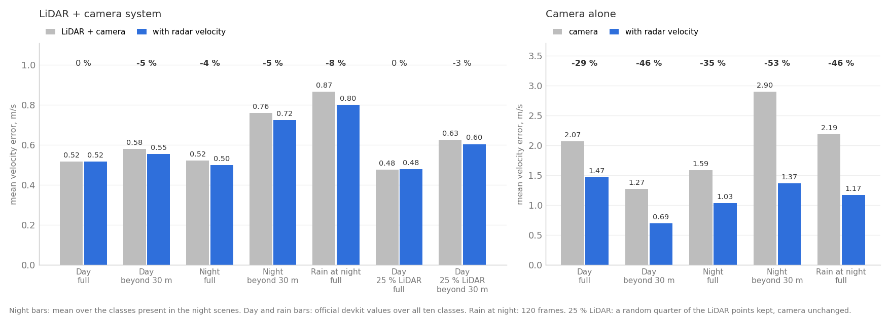
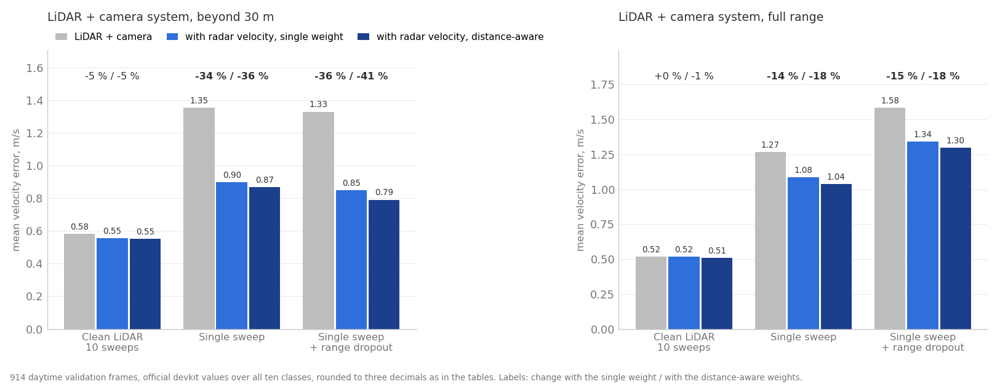

# Radar in LiDAR-Camera Late Fusion: The Sequence of Experiments

*An inference-only measurement on nuScenes of what a conventional automotive radar adds to camera and LiDAR plus camera 3D detection, carried out as four experiments, each asked by the result of the one before. This report explains the sequence; each experiment also has its own report with the full tables: [REPORT.md](REPORT.md), [REPORT_enhanced.md](REPORT_enhanced.md), [REPORT_degradation.md](REPORT_degradation.md) and [REPORT_velocity_degradation.md](REPORT_velocity_degradation.md).*

## Overview

The question throughout was a plain one: given a camera detector, a LiDAR detector and the five radars that nuScenes records, what does the radar add when it is fused late, after detection? Four experiments answered it in turn. The first measured radar's effect on clean daytime data and found that it changes velocity and nothing else, a lot for a camera-only system and little for a LiDAR plus camera system. The second repeated the measurement at night and in rain and found the same shape with a modest increase. The third thinned the LiDAR point cloud to see whether a weaker LiDAR changes the answer, and found that it does not: radar's contribution stayed the same because the thinning had removed detections, which a velocity measurement cannot restore. That result pointed at the one property radar provides directly, velocity, and the fourth experiment degraded exactly that, by running the LiDAR detector on a single sweep. There, radar's contribution went from 5 percent of the far-range velocity error to 36 percent, and to 41 percent when far points were also thinned.

All four experiments share one method. Public pretrained MMDetection3D checkpoints (CenterPoint for LiDAR, FCOS3D for the six cameras) are run as published on nuScenes keyframes. Radar returns are associated with detected boxes by position. Radar is used in two ways: as a velocity source, where a camera box takes the mean radar velocity of its returns and a LiDAR box blends in a fraction of it with a weight fitted on training frames, and as a re-scoring feature, where a logistic model re-ranks box confidence with radar counts and is cross-validated across validation scenes. Every number is the official nuScenes devkit on held-out validation keyframes: the nuScenes Detection Score (NDS), mAP, and the mean true-positive errors for translation (mATE) and velocity (mAVE). Radar velocity fusion never adds or removes a box, so mAP is identical with and without it; the comparisons are of velocity error and of NDS, which includes it.

| Experiment | Data | What was varied | Radar's effect on LiDAR + camera velocity error beyond 30 m |
| --- | --- | --- | --- |
| 1. Daytime baseline | blob 01, 914 validation keyframes, 23 daytime scenes | nothing; camera, LiDAR and fused systems with and without radar | 0.581 to 0.554 m/s, -5 % |
| 2. Night and rain | blob 10, 602 night keyframes, 120 of them in rain | the conditions | 0.760 to 0.725 m/s on the classes present, -5 %; -7 % with distance-aware weights |
| 3. Sparser LiDAR | blob 01, a random 25 % of the LiDAR points | the point density | 0.626 to 0.604 m/s, -4 %; -5 % distance-aware |
| 4. LiDAR without velocity | blob 01, LiDAR detector on one sweep instead of ten; then also range-dependent dropout | the LiDAR's own velocity estimate; then its far-range coverage | 1.354 to 0.867 m/s, -36 %; with dropout 1.329 to 0.790 m/s, -41 % |

For the camera-only system radar's effect is large in every experiment, 25 to 53 percent of the velocity error depending on condition and range, and is reported in experiments 1 and 2.

## Experiment 1. Does radar change what a LiDAR plus camera detector reports?

The first experiment established the baseline on clean daytime data: three detection systems, camera alone, LiDAR alone and LiDAR plus camera, each evaluated with and without radar, at full range and beyond 30 m. Radar changed velocity and nothing else. For the camera-only system the change was large; for the LiDAR plus camera system it was small and confined to far objects.

| System | NDS, full | mAP, full | mAVE full, m/s | mAVE beyond 30 m, m/s |
| --- | --- | --- | --- | --- |
| Camera | 0.406 | 0.315 | 2.071 | 1.275 |
| Camera + radar velocity | 0.406 | 0.315 | 1.469 | 0.694 |
| LiDAR | 0.578 | 0.483 | 0.522 | 0.574 |
| LiDAR + camera | 0.579 | 0.486 | 0.516 | 0.581 |
| LiDAR + camera + radar velocity, weight 0.1 | 0.579 | 0.486 | 0.516 | 0.554 |
| LiDAR + camera + radar velocity, distance-aware | 0.580 | 0.486 | 0.509 | 0.552 |
| LiDAR + camera + radar re-scoring | 0.568 | 0.469 | 0.545 | 0.559 |

Blob 01 of nuScenes, 914 validation keyframes from 23 daytime scenes in Boston and Singapore, official devkit values. The fused system keeps camera boxes only where no same-class LiDAR box lies within 2.5 m, so almost all of its boxes are LiDAR boxes, and the radar velocity weight fitted on the training scenes for those boxes came out at 0.1: the LiDAR's own velocity, estimated from point motion across ten accumulated sweeps, was already accurate to 0.25 m/s on training true positives, and the fit gave radar a small share. A weight fitted per distance bucket rose from 0.05 within 20 m to 0.30 beyond 40 m and gave the lowest far-range error, 0.552 m/s. Letting radar re-rank box confidence cost 1.1 NDS points and 1.7 mAP points, because the detector's own confidence ranked boxes better than a linear model over radar counts, and radar returns sat on many false positives too.

The box-origin breakdown of the fused true positives showed where the small gain lived: 4 percent on objects at 40 to 50 m, 5 percent on moving objects beyond 30 m, 34 percent on the 114 camera-origin boxes that survived the merge, and a 1 percent increase on parked objects, where a radial-only velocity adds noise to a near-zero estimate. Detection accuracy did not change with radar velocity at any range, because the fusion only edits velocities.

The experiment left two open questions. The first was whether the small fused-system gain was a property of clean daytime data, where the LiDAR has little to lose. The second was what the gain would look like if the LiDAR's own velocity estimate were worse.

## Experiment 2. Does the answer hold at night and in rain?

The second experiment repeated the measurement on a second nuScenes blob whose validation scenes are all at night, three of them in rain, to see whether the daytime shape of the result depended on good conditions. It did not: radar still changed velocity only, the camera-only system gained most, and the fused system's gain was a little larger than by day and now present at full range as well as beyond 30 m.

| Condition | Range | System | NDS | mAP | mAVE, m/s |
| --- | --- | --- | --- | --- | --- |
| Night, 602 frames | Full, classes present | LiDAR + camera | 0.342 | 0.350 | 0.521 |
| Night | Full, classes present | + radar velocity | 0.344 | 0.350 | 0.498 |
| Night | Beyond 30 m, classes present | LiDAR + camera | 0.215 | 0.293 | 0.760 |
| Night | Beyond 30 m, classes present | + radar velocity | 0.217 | 0.293 | 0.725 |
| Night | Beyond 30 m, classes present | + radar velocity, distance-aware | | 0.293 | 0.709 |
| Rain at night, 120 frames | Full | LiDAR + camera | 0.214 | 0.185 | 0.866 |
| Rain at night | Full | + radar velocity | 0.221 | 0.185 | 0.800 |
| Night | Full | Camera | 0.222 | 0.140 | 1.367 |
| Night | Full | Camera + radar velocity | 0.222 | 0.140 | 1.022 |
| Night | Beyond 30 m | Camera | 0.105 | 0.015 | 1.951 |
| Night | Beyond 30 m | Camera + radar velocity | 0.105 | 0.015 | 1.184 |

Blob 10, 15 validation scenes in Singapore's Holland Village, residential streets at night, 7.5 annotated objects per frame against 33 by day. The night scenes contain no bus, trailer or construction vehicle, and the devkit scores an absent class as zero AP and a velocity error of 1.0 m/s, so the mAP and mAVE columns are averaged over the classes with at least 20 ground-truth boxes; the NDS is the official value and is low for every system for the same reason. The fused system's velocity gain was 4.4 percent at full range and 4.6 percent beyond 30 m, 6.7 percent with the distance-aware weights refitted on both blobs, which raised the far-range weights to 0.15 and 0.35. The camera-only system's gain was 25 percent at full range, 39 percent beyond 30 m and 46 percent in rain. Re-scoring cost accuracy again, and dropped far-range car AP from 0.573 to 0.474.

The experiment answered the first open question: the fused system's gain is not an artefact of daytime data, and it grows a little where the LiDAR's velocity is noisier, which the night scenes, with fewer points per object, provide. The size of that growth, from 4.6 to 6.7 percent, suggested that the LiDAR's velocity quality, not the lighting, was the variable that mattered.

## Experiment 3. Does a sparser LiDAR change the answer?

The third experiment degraded the LiDAR directly, by keeping a uniform random quarter of the points of the aggregated cloud before the detector, on the same daytime frames as experiment 1. The detector lost accuracy, and radar's contribution did not change: the far-range velocity cut was 3.5 percent with the single weight and 5.1 percent with distance-aware weights, against 4.6 and 5.0 percent with the full cloud, and at full range there was again no change.

| System | NDS, full | mAP, full | mAVE full, m/s | NDS, beyond 30 m | mAP, beyond 30 m | mAVE beyond 30 m, m/s |
| --- | --- | --- | --- | --- | --- | --- |
| LiDAR, full cloud | 0.578 | 0.483 | 0.522 | 0.400 | 0.257 | 0.574 |
| LiDAR, 25 % of points | 0.562 | 0.445 | 0.476 | 0.369 | 0.213 | 0.634 |
| LiDAR + camera, 25 % | 0.562 | 0.450 | 0.476 | 0.370 | 0.215 | 0.626 |
| + radar velocity, weight 0.1 | 0.562 | 0.450 | 0.478 | 0.372 | 0.215 | 0.604 |
| + radar velocity, distance-aware | 0.563 | 0.450 | 0.468 | 0.373 | 0.215 | 0.594 |
| + radar re-scoring | 0.547 | 0.434 | 0.541 | 0.361 | 0.197 | 0.622 |

The refitted single weight came out at 0.1 again, and the distance-aware weights moved only at range, from 0.10 and 0.30 to 0.20 and 0.45 for 30 to 40 m and beyond 40 m. The reason was visible in the training fit: the LiDAR's velocity error on its own true positives had barely moved (0.20 to 0.41 m/s by distance bucket with the full cloud, 0.19 to 0.48 m/s with a quarter of it), because the detector's velocity comes from motion across ten accumulated sweeps and a uniform subsample keeps that motion. What the thinning removed was detections, the small and far objects first (motorcycle AP 0.167 to 0.082, far pedestrian AP 0.708 to 0.600), and a velocity measurement cannot put a missing box back. The full-range velocity error even fell under thinning, from 0.516 to 0.476 m/s, because the matched set shrank from 18,403 to 17,354 true positives and lost the hard ones; beyond 30 m, where the sets are more alike, it rose from 0.581 to 0.626 m/s as expected.

The experiment answered the question it asked, and it narrowed the second open question. A LiDAR degradation that leaves the detector's velocity estimate intact leaves radar's contribution intact; if that contribution depends on anything, it depends on the LiDAR's velocity, and the next experiment degraded that alone.

## Experiment 4. Which property of the LiDAR does radar's contribution depend on?

The fourth experiment removed the LiDAR's velocity estimate while keeping its detections, by running the detector on a single past sweep instead of nine. CenterPoint infers velocity from the time offsets of the points it sees; one sweep gives it a 0.05 s baseline instead of 0.5 s. The detections largely survived (mAP 0.486 to 0.408, with 91,707 confident boxes against 100,805) and the velocity estimate did not: the fused system's error rose from 0.516 to 1.266 m/s at full range and from 0.581 to 1.354 m/s beyond 30 m. Radar velocity then recovered 14 to 18 percent of the full-range error and 34 to 36 percent of the far-range error, and the far-range NDS, which includes velocity, rose with radar for the first time, from 0.292 to 0.305.

A second condition added a range-dependent point dropout on top of the single sweep, keeping all points within 20 m and 10 percent beyond 40 m, the way weather and low reflectivity thin a cloud. Far detections then collapsed (LiDAR-only mAP beyond 30 m 0.183 to 0.036) and radar's far-range velocity cut reached 36 to 41 percent. In this condition two further things happened. A camera-heavier merge rule, which lets a camera box stand in for a LiDAR box scoring below 0.3, raised far-range mAP from 0.057 to 0.072 and, with radar, gave the highest far-range NDS of the condition, 0.230 against 0.196. And radar re-scoring, which had cost accuracy in every earlier condition, raised far-range NDS from 0.196 to 0.228 and was neutral at full range: once the LiDAR is nearly blind at range, a radar return behind a box is evidence that the detector's own confidence no longer provides.

| Condition | System | NDS, beyond 30 m | mAP, beyond 30 m | mAVE beyond 30 m, m/s | mAVE full, m/s |
| --- | --- | --- | --- | --- | --- |
| Full cloud, 10 sweeps | LiDAR + camera | 0.399 | 0.257 | 0.581 | 0.516 |
| Full cloud, 10 sweeps | + radar velocity, distance-aware | 0.402 | 0.257 | 0.552 | 0.509 |
| Single sweep | LiDAR + camera | 0.292 | 0.187 | 1.354 | 1.266 |
| Single sweep | + radar velocity, single weight | 0.302 | 0.187 | 0.898 | 1.084 |
| Single sweep | + radar velocity, distance-aware | 0.305 | 0.187 | 0.867 | 1.036 |
| Single sweep | camera-heavier merge + radar velocity | 0.308 | 0.188 | 0.864 | 1.077 |
| Single sweep + range dropout | LiDAR + camera | 0.196 | 0.057 | 1.329 | 1.584 |
| Single sweep + range dropout | + radar velocity, distance-aware | 0.217 | 0.057 | 0.790 | 1.298 |
| Single sweep + range dropout | camera-heavier merge + radar velocity | 0.230 | 0.072 | 0.809 | 1.334 |
| Single sweep + range dropout | + radar re-scoring | 0.228 | 0.062 | 0.797 | 1.423 |

The fitted weights told the same story as the metrics. The single radar weight for LiDAR boxes, 0.1 in experiments 1 and 3, refitted to 0.8; the distance-aware weights went from 0.05 / 0.05 / 0.10 / 0.30 to 0.40 / 0.65 / 0.90 / 0.95 with a single sweep and to 0.40 / 0.75 / 1.00 / 1.00 with range dropout, because the LiDAR's own velocity error on training true positives had risen from 0.20 to 0.41 m/s by bucket to 0.41 to 1.43 m/s. Per class beyond 30 m, the single-sweep gain was 40 percent on cars (1.60 to 0.96 m/s), 45 percent on trucks, 69 percent on buses and 54 percent on bicycles; pedestrians got slightly worse (0.58 to 0.65 m/s), the one class where radar returns are too few and too noisy to help. The single weight also over-trusted radar close in, raising the error about 10 percent within 20 m and on slow objects, which the distance-aware weights avoid.

This experiment answered the second open question. Radar's contribution to a LiDAR plus camera system is governed by the quality of the LiDAR's own velocity estimate: small when the LiDAR accumulates sweeps and measures velocity well, large when it cannot.

## Figures

*Experiments 1 and 2. Mean velocity error of the LiDAR + camera system (left) and of the camera alone (right), with and without radar velocity, by condition and range. Night bars are averaged over the classes present in the night scenes; day and rain bars are official devkit values over all ten classes.*

*Experiment 4, with experiment 1 as the reference. Mean velocity error of the LiDAR + camera system beyond 30 m (left) and at full range (right), without radar, with the single refitted radar weight and with the distance-aware weights, for the full cloud with ten sweeps, a single sweep, and a single sweep with range-dependent dropout.*

## What the sequence shows

Taken together, the four experiments give one consistent account of a conventional radar in a late-fusion detector.

- **Radar supplies velocity, not detection.** In every experiment, radar velocity fusion left mAP exactly unchanged, and the one way of using radar for detection, re-scoring box confidence, cost accuracy whenever the LiDAR's own confidence was informative. Radar helped detection only in the single condition where the LiDAR was nearly blind at range.
- **The size of the velocity gain is set by the other sensor's velocity quality.** A camera detector estimates velocity poorly, and radar cut its error by 29 percent by day, 25 percent at night and 46 percent in rain, up to 53 percent beyond 30 m. A LiDAR detector with ten accumulated sweeps estimates velocity well, and radar cut its error by 5 percent beyond 30 m and nothing at full range. A LiDAR detector on a single sweep estimates velocity poorly, and radar cut its error by 36 percent beyond 30 m and 18 percent at full range. The night scenes, with fewer points per object, sat between the daytime and the single-sweep cases.
- **The fitted weights track that quality.** The share of radar velocity the fusion takes for LiDAR boxes, fitted on training frames, was 0.1 with ten sweeps, 0.1 with a quarter of the points, and 0.8 with one sweep, rising to 1.0 beyond 30 m with range dropout.
- **Range matters more than condition.** In every experiment the gain was larger beyond 30 m than at full range, because near objects have dense LiDAR returns and a good LiDAR velocity, and far objects do not. Distance-aware weights, which trust radar more at range, were the best setting in every condition and cost nothing at full range.
- **Two costs recur.** Radar velocity made pedestrians slightly worse wherever the LiDAR's own estimate was usable, and a single large weight made close, slow objects worse; distance-aware weights fix the second and a per-class weight would address the first.

The practical reading is that in a system whose LiDAR accumulates sweeps, radar's velocity is a modest far-range refinement; in a system whose LiDAR cannot accumulate sweeps, or whose far-range returns are thinned by conditions, radar's velocity is the only good velocity estimate the system has beyond 30 m, and the late fusion recovers a third to two fifths of the error.

## Limits that apply across the experiments

- **Subset size.** 914 daytime and 602 night validation keyframes from 38 scenes, with 120 rain frames from three consecutive drives on one street. Differences under about 0.01 NDS or 0.01 m/s are within noise; the far-range rows of the night and of the range-dropout conditions rest on a few hundred objects.
- **Class padding at night.** The night scenes contain no bus, trailer or construction vehicle, and the devkit scores an absent class as zero AP and a velocity error of 1.0 m/s, so the official night mAP and mAVE carry padding that no system can remove. The night numbers quoted here are averaged over the classes present; comparisons between systems within a slice are unaffected either way.
- **Degradations are models, not weather.** Uniform thinning, a single sweep and a range-dependent keep probability are stand-ins for sparse returns, a non-accumulating LiDAR and distance-dependent loss; none adds the clutter weather adds, and each was drawn once. The night and rain rows are the measured weather numbers.
- **Detectors not adapted.** CenterPoint and FCOS3D are used as published. A detector trained on single sweeps or sparse clouds would detect better and might estimate velocity somewhat better, though it would still lack the time baseline that sweep accumulation provides.
- **Conventional radar and a LiDAR-primary design.** nuScenes radars report no elevation and a few hundred returns per frame, and about half of the fused true positives have a radar return at all. The fused system keeps camera boxes only where LiDAR finds nothing, so radar's large effect on camera boxes touches few fused boxes; the camera-heavier merge tested in experiment 4 moved that boundary a little. A 4D radar, or a tracker that integrates Doppler over time, would do more.
- **Everything fitted is small.** A velocity weight per box origin, or per origin and distance bucket, fitted on training scenes; a logistic re-ranker cross-validated across validation scenes.

## Reports, files and reproduction

Each experiment has its own report with the full tables, the per-class and box-origin breakdowns, its figure and its reproduction commands; this report summarises them and adds nothing that is not in them.

| Experiment | Report | File |
| --- | --- | --- |
| 1. Daytime baseline | Radar Contribution to LiDAR-Camera Fusion | [REPORT.md](REPORT.md) |
| 2. Night and rain | Radar Contribution to LiDAR-Camera Fusion, Day and Night | [REPORT_enhanced.md](REPORT_enhanced.md) |
| 3. Sparser LiDAR | Radar Contribution to LiDAR-Camera Fusion with Degraded LiDAR | [REPORT_degradation.md](REPORT_degradation.md) |
| 4. LiDAR without velocity | Radar Contribution When the LiDAR Cannot Measure Velocity | [REPORT_velocity_degradation.md](REPORT_velocity_degradation.md) |

The pipeline is the same for every experiment: `colab/nuscenes_inference.ipynb` runs the two detectors on one nuScenes blob (its settings cell selects the blob, the LiDAR point-keep ratio, the number of sweeps and the range-dependent keep probability), `scripts/fuse.py` associates radar and writes the fused result files for every system (`--merge weak-lidar` for the camera-heavier rule), `scripts/blend_by_distance.py` fits the distance-aware weights, `scripts/evaluate.py` runs the official devkit on the frames at hand with optional range and scene filters, `scripts/slice_metrics.py` averages over the classes present in a slice, and `scripts/analyze_lc_radar.py` produces the box-origin breakdown. Detector outputs are `detections/*.json`, fused files `results/fused_*/`, devkit summaries `results/eval_*/summary_*.json`, fitted weights `results/blend_by_distance_*.json`, breakdowns `results/analysis_lc_radar_*.json`. The nuScenes data is not redistributed.

## Sources

- nuScenes: Caesar et al., *nuScenes: A multimodal dataset for autonomous driving*, CVPR 2020. Data used under CC BY-NC-SA 4.0 for non-commercial research.
- CenterPoint: Yin, Zhou and Krähenbühl, *Center-based 3D Object Detection and Tracking*, CVPR 2021. Checkpoint from MMDetection3D.
- FCOS3D: Wang et al., *FCOS3D: Fully Convolutional One-Stage Monocular 3D Object Detection*, ICCV Workshops 2021. Checkpoint from MMDetection3D.
- MMDetection3D: OpenMMLab, version 1.4.0.
